

  

<h1 align="center">photoboggan</h1>

  <em>A fast, local photo library for browsing, organizing and rediscovering your pictures.</em>

  <a href="#why-photoboggan">Why photoboggan</a> ·
  <a href="#features">Features</a> ·
  <a href="#privacy-and-file-safety">Privacy & safety</a> ·
  <a href="#screenshots">Screenshots</a> ·
  <a href="https://github.com/alexh3o/photoboggan/releases">Downloads</a>

---

## Why photoboggan?

After 25 years of photographing as a hobbyist and a dad, I wanted less time spent repeating organizing chores and more time enjoying the collection. photoboggan is built for family and hobby photographers who want large personal libraries to be quick to browse, easy to organize and pleasant to explore.

It works directly with your existing folders: no import step, proprietary library or duplicate photo vault. Its interface keeps photos in focus, adapts to your workflow and stays responsive with collections of **200,000+ photos**.

**[Download the latest release](https://github.com/alexh3o/photoboggan/releases)** · **[Read the user guide](docs/USER_GUIDE.md)** · **[Watch the quick tour](webpage/photoboggan_quickshow.webm)**

## Features

### Browse, rate and organize

- Scroll quickly by grabbing and releasing the photo grid; tune thumbnail layout, size, spacing, sorting, fonts, themes and panel sizes.
- Work with square, masonry and justified layouts. Hide or rearrange the library, filters, preview, info, keywords, description and toolbar panels.
- Rate with stars, color labels and pick flags using rating bars and shortcuts; optionally advance to the next photo automatically.
- Edit hierarchical keywords individually or in batches while preserving untouched keywords. Save and recall author and copyright presets.
- Create manual virtual albums and dynamic smart albums. Nest smart albums inside other albums to refine their filters.
- Filter by filename, format, keyword presence or absence, map area, ratings, color, pick status, dates, author, people, camera, lens and exposure settings.

### Find photos with optional local AI

- **Face detection and recognition:** optional, disabled by default, and processed locally with **YuNet** and **SFace**. Review high-confidence matches first, refine recognition with your choices, batch-process faces and keep the photo preview in context.
- **Content search:** optional **SigLIP 2** image analysis runs locally. Search with text, find visually similar scenes and get keyword suggestions from already-tagged photos. A first analysis scan is required and can take hours for collections over 100,000 photos.
- **Duplicate finder:** after an initial perceptual-hash scan, find exact duplicates, visually similar photos and filename matches; rank groups with customizable “Best Copy” rules.
- **Find the RAW:** match a JPEG to its RAW counterpart with adjustable matching rules.

### View, compare and locate

- View RAW photos using their embedded JPEG previews; no CPU demosaicing. Videos use operating-system thumbnails and open in the system player.
- Preview and fullscreen views support instant 1:1 zoom, pan, gradual zoom, optional face overlays, histograms, highlight/shadow clipping and photo information.
- Compare two to four photos with synchronized or independent zoom and pan; rate or delete a subselection. Combine Ctrl/Shift-click selections to build multiple groups.
- Explore geotagged photos on optional **MapLibre GL** maps, filter by the visible area, or drag photos onto the map to add locations.
- Cache map areas for reuse or use local MBTiles. Private zones keep photos in those areas in local-only map mode; erase GPS data before sharing and restore it later from a local backup.

### Work with files and metadata

- Batch-resize to a folder, batch-copy, rename, rotate losslessly through metadata, or reveal a photo or its folder in the operating-system file manager. Resize preserves color profiles and metadata.
- Choose editable **Open with** applications by file type: Raster, RAW or Video.
- Edit standard embedded metadata with ExifTool or the faster built-in writer. ExifTool supports the broadest formats; the internal writer focuses on XMP/IPTC and avoids risky EXIF writes. JPEG and HEIC/HEIF metadata stays embedded; other supported formats use standard XMP sidecars.
- Read EXIF, IPTC and XMP metadata, including common third-party schemes, with a user-editable source priority.
- Run an integrity scan to check files for potential corruption and generate missing thumbnails.

### Stay responsive with large collections

- SQLite, virtual thumbnail pagination (up to 50,000 thumbnails) and a 256-subfolder thumbnail cache keep large libraries manageable.
- Significant operations run in a low-priority task queue with progress, pause and cancel controls. Most work feels immediate after the initial library, thumbnail and optional AI scans; integrity scans take longer.
- Choose where the database, thumbnails and private maps are stored, and set the thumbnail cache resolution.
- Use the in-app shortcut guide, contextual tooltips and slideshow. Version update checks are available when Offline mode is off; downloaded installers are checked against their published SHA-256 checksum.

## Privacy and file safety

- Photos stay in your folders and are not uploaded for face or content analysis. Optional AI models are downloaded only when requested and run locally.
- Offline mode blocks outside connections while keeping core features available. Download face models, the content model and map files first if you need them offline.
- Private Photos can quickly hide or reveal images using combined folder/path, keyword and date-range rules.
- **Metadata writes do not alter or recompress image data.** Writes use a temporary file, are verified by reading metadata back, and attempt to restore the original after a failure. If restoration is not possible, photoboggan warns that the remaining `.tmp` file may need manual recovery.
- File and folder operations warn about conflicts such as existing or hidden files. Batch resize creates resized output files as requested.

## Availability

The application is in beta. Keep a complete backup of your photo collection.

- **Windows:** `.msi` installers are available on the [Releases page](https://github.com/alexh3o/photoboggan/releases).
- **Linux:** `.deb` packages are available for Ubuntu/Debian.
- **macOS:** no release is currently published.

## Screenshots

### The photo library

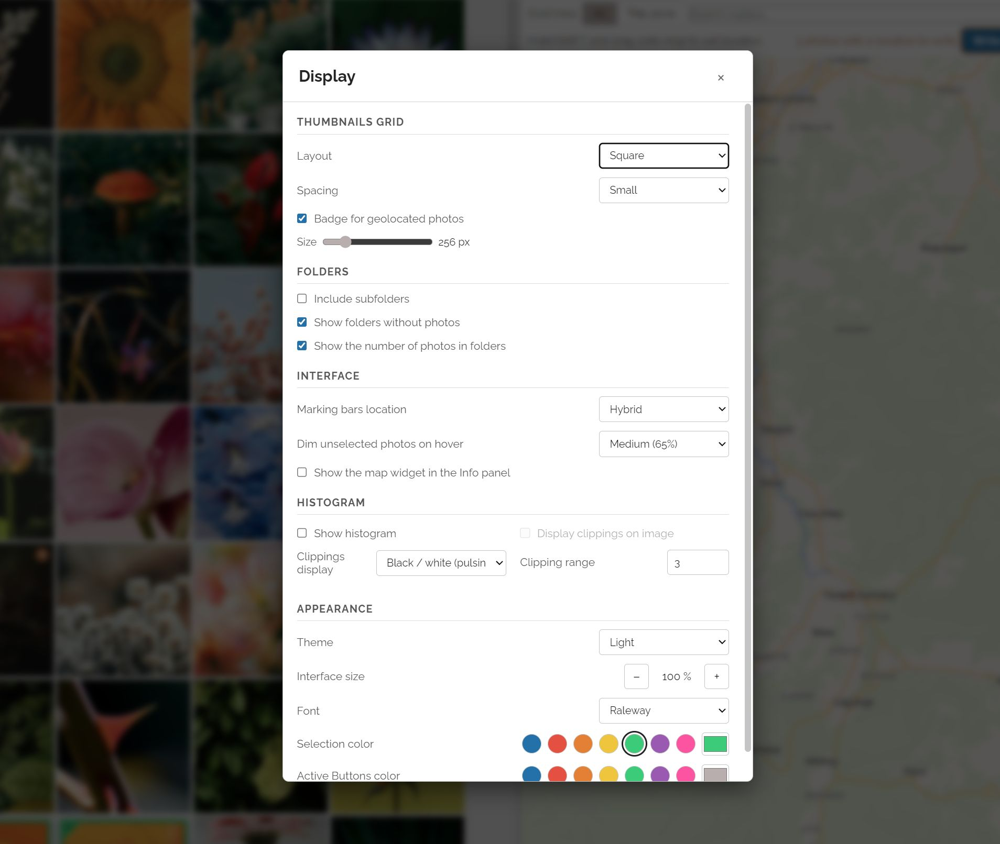

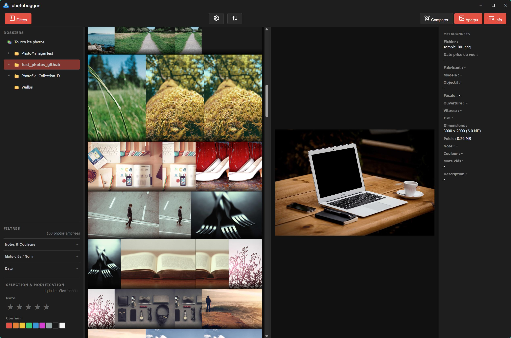

### Browse and preview

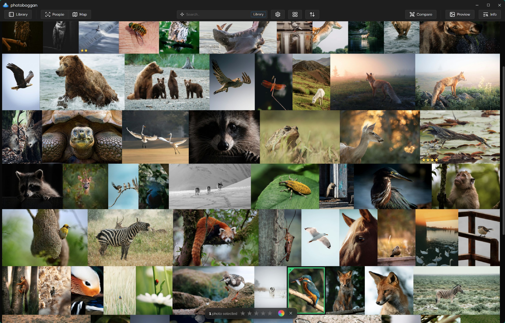

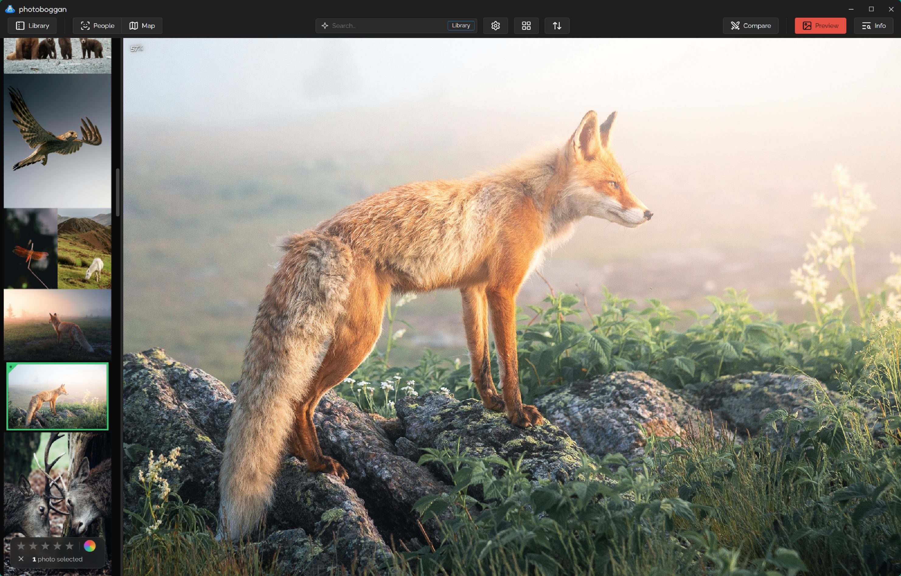

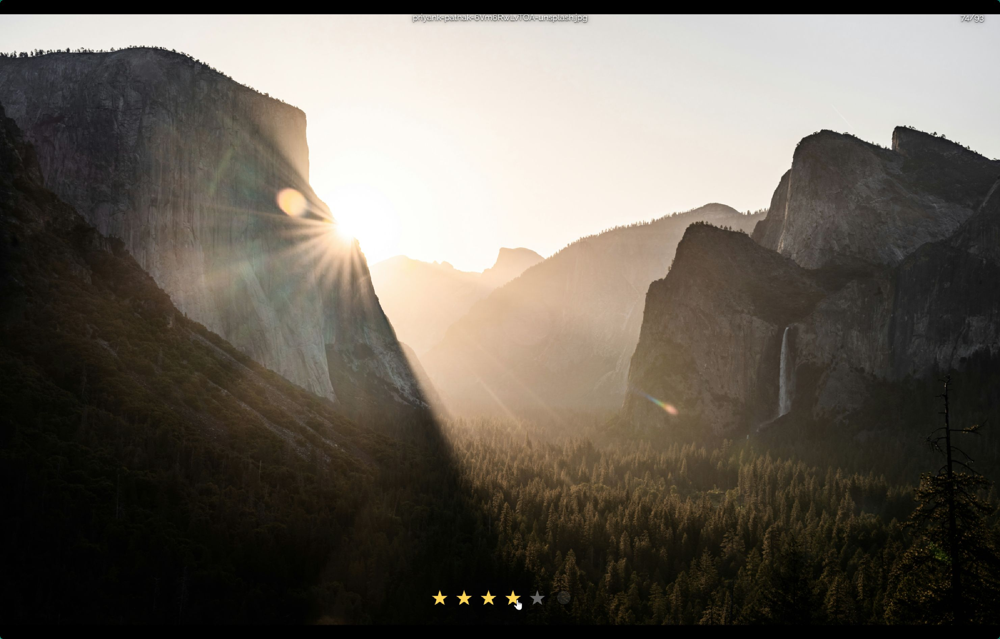

### Organize and find

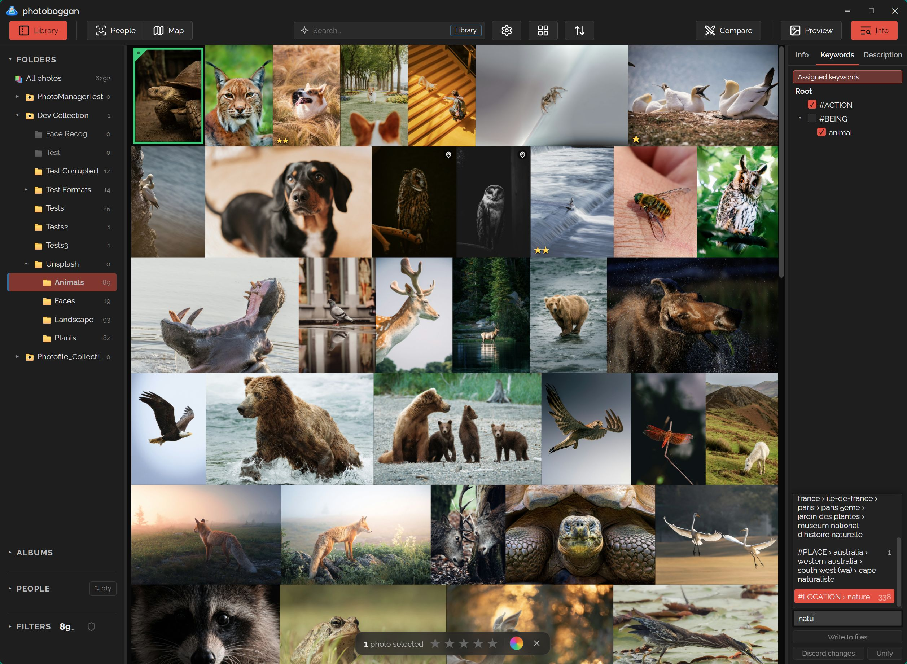

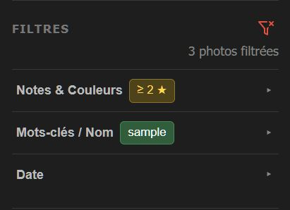

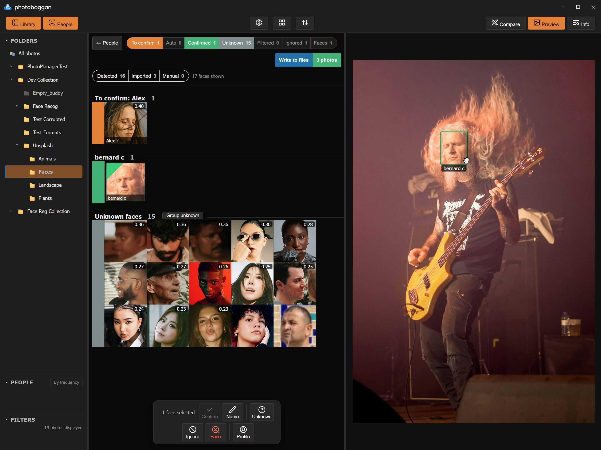

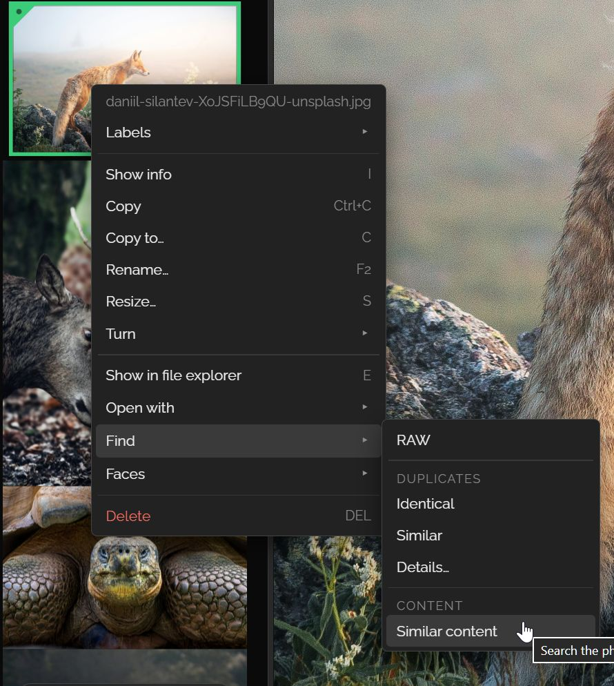

### Maps and collection tools

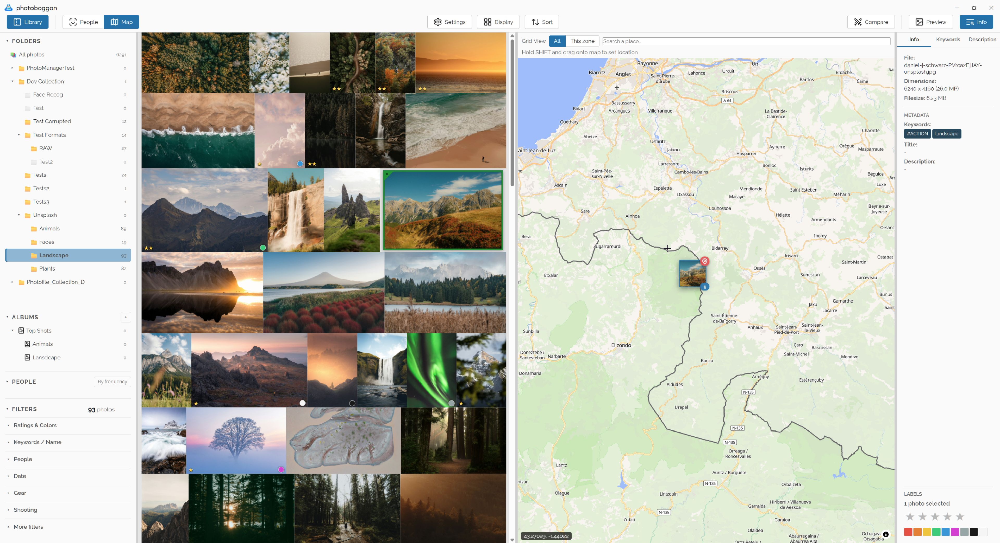

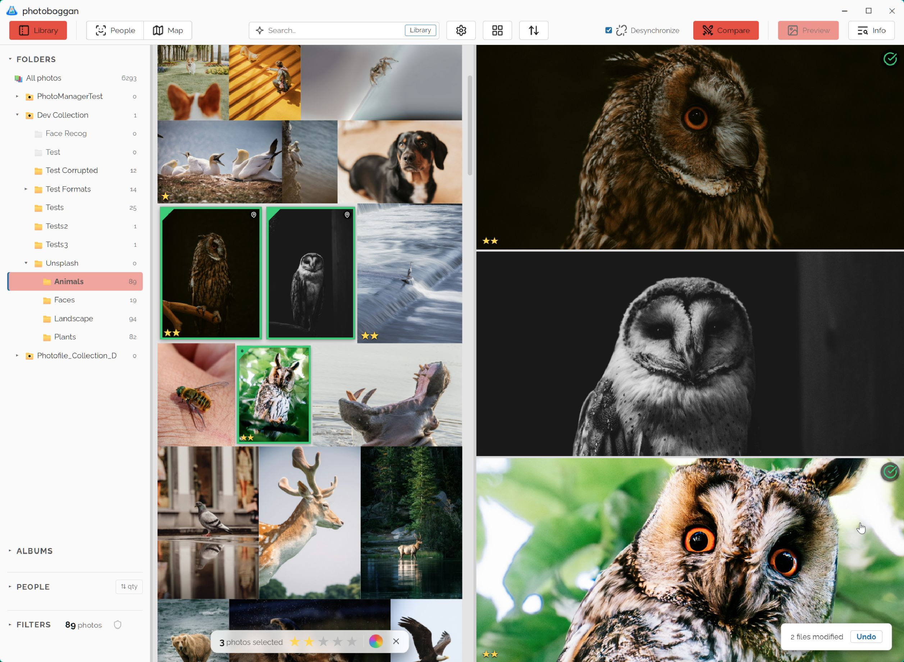

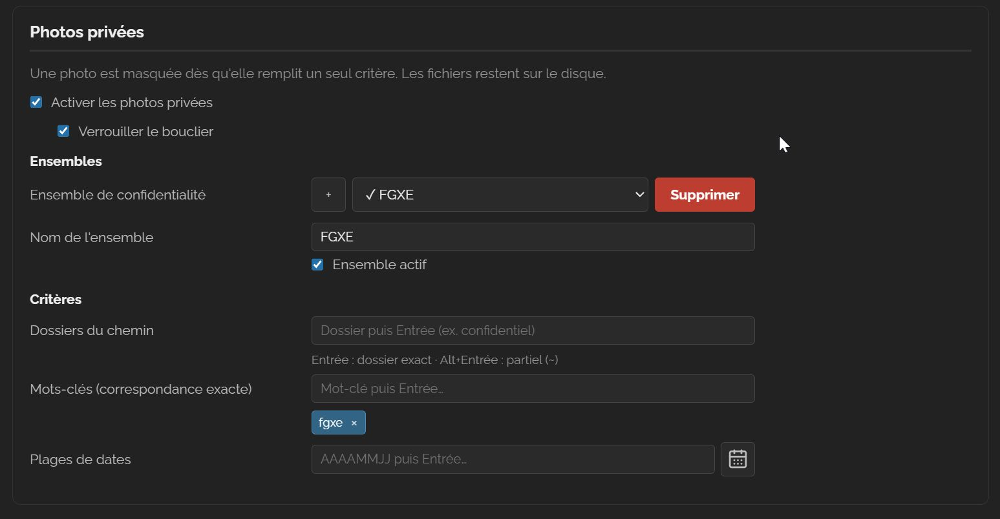

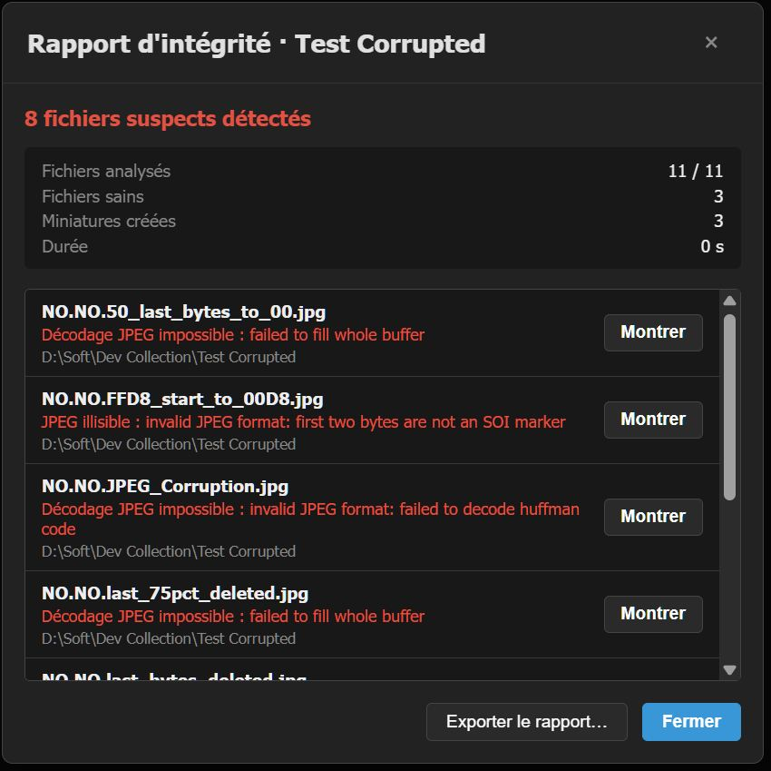

## License and third-party components

photoboggan is distributed under the **GNU GPL v3.0**; see [LICENSE](LICENSE).

Optional components are downloaded on request and are not bundled in the installer:

- **YuNet** face detection: MIT License.
- **SFace** face recognition: Apache License 2.0.
- **SigLIP 2** content search model (`google/siglip2-base-patch16-224`, ONNX export by `onnx-community`): Apache License 2.0.
- **ONNX Runtime:** MIT License.

Map tiles and styles use [OpenFreeMap](https://openfreemap.org) (MIT), [OpenMapTiles](https://openmaptiles.org) (BSD 3-Clause code, CC BY 4.0 design) and [OpenStreetMap](https://www.openstreetmap.org/copyright) data (ODbL). The style includes Maki icons (CC0) and Noto Sans glyphs (SIL OFL 1.1); see [map style licenses](src-tauri/resources/map-style/LICENSES.md) for full attribution. Place search uses Nominatim and OpenStreetMap data (ODbL).

Photos in the screenshots are from Lorem Picsum and Unsplash. Designed and developed by alexh3o.
